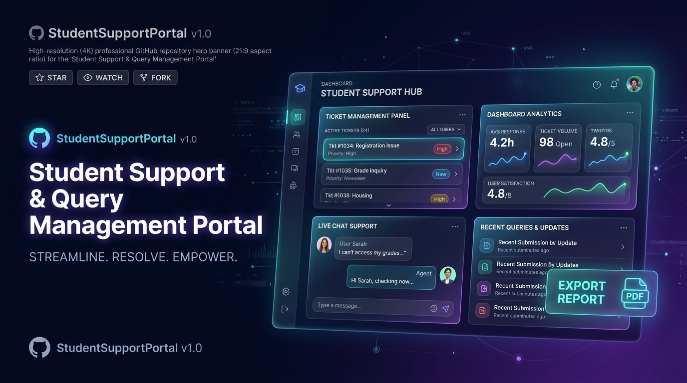
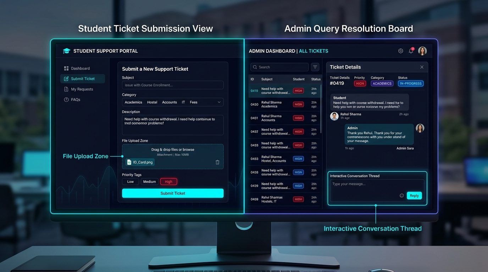
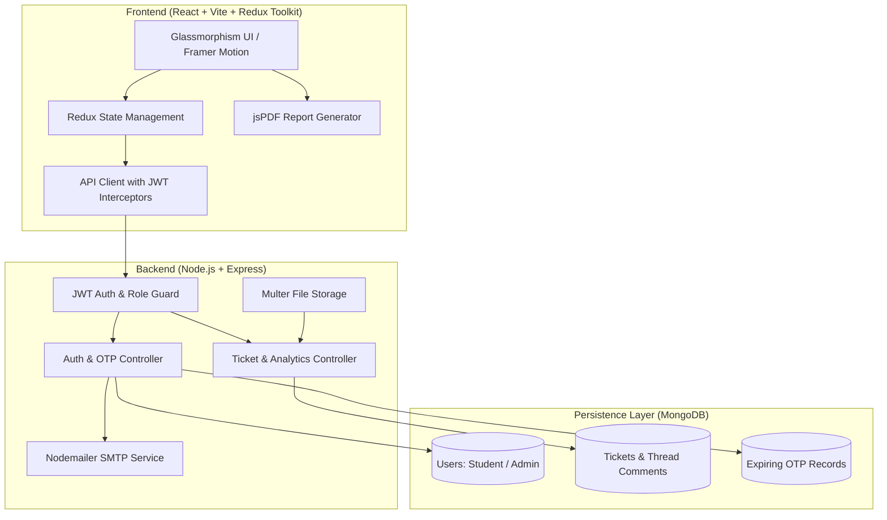

# 🎓 Student Support & Query Management Portal (Help Desk)

<div align="center">



[](https://react.dev/)
[](https://nodejs.org/)
[](https://www.mongodb.com/)
[](https://redux-toolkit.js.org/)
[](https://jwt.io/)
[](LICENSE)

<br/>

**A modern, production-grade two-way interactive query resolution and ticket management portal designed for universities, colleges, and educational institutes.**

[Explore Features](#-key-features) • [UI Showcase](#-ui-showcase) • [Architecture](#-system-architecture) • [API Reference](#-api-endpoints) • [Quick Start](#-getting-started)

</div>

---

## 📌 Executive Overview

The **Student Support & Query Management Portal** streamlines communication between students and academic administrations. Replacing slow, scattered email threads and manual paper forms, this platform provides real-time ticket tracking, interactive discussion threads, diagnostic file attachment handling, and instant automated analytics reporting.

### 🌟 Why This Portal?
* **Zero Lost Queries:** Every issue has a dedicated ticket ID, priority level, category tag, and status lifecycle (`Open` ➔ `In-Progress` ➔ `Resolved`).
* **Two-Way Transparency:** Real-time comment threads allow back-and-forth dialogue between students and department admins directly inside tickets.
* **Administrative Intelligence:** Built-in dashboard metrics and one-click PDF generation give department heads instant visibility into ticket resolution efficiency.

---

## 🚀 Key Features

### 👨‍🎓 For Students
* **OTP-Verified Onboarding:** Email verification via automated 6-digit OTPs before account creation ensures only legitimate campus members join.
* **Intuitive Query Submission:** Submit tickets specifying subject, detailed description, branch, academic category, and priority urgency.
* **File & Media Attachments:** Upload screenshots, assignment files, or fee receipts directly with `multipart/form-data` uploads (powered by Multer).
* **Live Query Tracking:** Real-time visibility into query status, assigned administrative responses, and timestamped resolution updates.
* **Interactive Discussion Thread:** Reply to administrative clarifications and add follow-up notes inside the ticket.

### 🛡️ For Administrators
* **Central Command Center:** Real-time triage dashboard displaying overall ticket statistics, pending urgent issues, and resolution ratios.
* **Deep Multi-Filter Search:** Filter incoming queries dynamically by **Status**, **Priority** (Urgent, Normal, Low), **Department/Category** (Academics, Hostel, Accounts, Library, Infrastructure), or **Branch**.
* **Status Lifecycle Management:** Update ticket progression with immediate feedback to the student.
* **Official Query Resolution:** Post formal administrative rulings or responses directly to the student thread.
* **One-Click PDF Analytics Export:** Auto-generate styled, downloadable summary audit reports with category breakdowns using `jsPDF` and `autoTable`.

---

## 🖼️ UI Showcase

<div align="center">



*Dual-Dashboard Architecture: Student Ticket Submission View (Left) & Admin Query Resolution Board (Right)*

</div>

---

## 🏗️ System Architecture



---

## 🛠️ Technology Stack

| Domain | Technologies Used | Purpose |
| :--- | :--- | :--- |
| **Frontend Framework** | React 18, Vite | Ultra-fast SPA rendering & bundling |
| **State Management** | Redux Toolkit (`@reduxjs/toolkit`, `react-redux`) | Predictable global state for auth & queries |
| **UI & Styling** | Vanilla CSS3, Glassmorphism, CSS Variables | Tailored modern theme with responsive layouts |
| **Motion & Dynamics** | Framer Motion, React-Parallax-Tilt | Micro-animations and 3D interactive dashboard cards |
| **Icons & Visuals** | React Icons (`react-icons/fi`, `react-icons/ri`) | Modern Feather and Remix icon sets |
| **Report Generation**| `jspdf`, `jspdf-autotable` | Client-side dynamic PDF compilation |
| **Backend Runtime** | Node.js, Express.js | Scalable RESTful API service |
| **Database & ODM** | MongoDB, Mongoose | Document-based persistence with relational refs |
| **Authentication** | JSON Web Tokens (JWT), Bcrypt.js | Stateless session tokens & secure password hashing |
| **File Handling** | Multer | Binary multipart uploads with MIME-type filtering |
| **Email & Delivery** | Nodemailer | Automated OTP generation and delivery |

---

## 📡 API Endpoints

### 🔐 Authentication (`/api/auth`)
| Method | Endpoint | Access | Description |
| :--- | :--- | :--- | :--- |
| `POST` | `/api/auth/send-otp` | Public | Dispatches a 6-digit verification code to the target email |
| `POST` | `/api/auth/register` | Public | Validates OTP and creates a new Student or Admin account |
| `POST` | `/api/auth/login` | Public | Authenticates credentials and returns a signed JWT |
| `GET` | `/api/auth/profile` | Authenticated | Retrieves current authenticated profile information |
| `PUT` | `/api/auth/profile` | Authenticated | Updates student or admin profile fields |

### 🎫 Query Management (`/api/queries`)
| Method | Endpoint | Access | Description |
| :--- | :--- | :--- | :--- |
| `POST` | `/api/queries` | Student | Creates a new support ticket with optional file attachment |
| `GET` | `/api/queries/my` | Student | Fetches all tickets submitted by the logged-in student |
| `GET` | `/api/queries` | Admin | Fetches all system tickets with filter & search query parameters |
| `PUT` | `/api/queries/:id/status` | Admin | Updates ticket progression (`Open`, `In-Progress`, `Resolved`) |
| `POST` | `/api/queries/:id/comments`| Authenticated | Posts a new message to the query's discussion thread |
| `GET` | `/api/queries/analytics`| Admin | Returns aggregate metrics and category breakdown for reports |

---

## 📂 Project Directory Structure

```text
School_Management_System/
├── backends/                      # Express & Node.js API Service
│   ├── config/
│   │   └── db.js                  # MongoDB Mongoose connection
│   ├── controllers/
│   │   ├── authController.js      # Register, login, OTP verification
│   │   └── queryController.js     # Ticket CRUD, threads, analytics
│   ├── middlewares/
│   │   ├── authMiddleware.js      # JWT authentication & admin protection
│   │   └── uploadMiddleware.js    # Multer file storage handler
│   ├── models/
│   │   ├── OTP.js                 # Temporary TTL verification records
│   │   ├── Query.js               # Tickets, attachments & threaded comments
│   │   └── User.js                # User profiles and roles
│   ├── routes/
│   │   ├── authRoutes.js          # Authentication routing
│   │   └── queryRoutes.js         # Query lifecycle routing
│   ├── services/
│   │   └── emailService.js        # Nodemailer SMTP transporter
│   ├── uploads/                   # Local storage for uploaded attachments
│   ├── index.js                   # Main application entry point
│   └── package.json
│
├── frontend/                      # React 18 + Vite SPA Client
│   ├── public/                    # Static icons, logos & branding
│   ├── src/
│   │   ├── assets/                # Vector assets and illustrations
│   │   ├── components/
│   │   │   ├── EditProfileModal.jsx # User profile management modal
│   │   │   ├── Navbar.jsx         # App navigation with logout & collapse
│   │   │   └── UIComponents.jsx   # Status badges, spinners, alert blocks
│   │   ├── pages/
│   │   │   ├── AdminDashboard.jsx # Admin oversight, filters & PDF export
│   │   │   ├── Login.jsx          # Auth split screen with OTP verification
│   │   │   └── StudentDashboard.jsx# Student ticket submission & history
│   │   ├── redux/
│   │   │   ├── authSlice.js       # Authentication state & async thunks
│   │   │   ├── querySlice.js      # Query management state & actions
│   │   │   └── store.js           # Central Redux store
│   │   ├── utils/
│   │   │   └── constants.js       # App categories, priorities & departments
│   │   ├── App.jsx                # Route protection and layout router
│   │   ├── index.css              # Glassmorphism design tokens & styles
│   │   └── main.jsx
│   ├── vite.config.js
│   └── package.json
│
├── docs/                          # Project documentation assets
│   └── images/
│       ├── banner.png             # Hero repository banner
│       └── features.png           # UI features preview
└── README.md
```

---

## ⚡ Getting Started

Follow these step-by-step instructions to set up and run the system locally.

### 📋 Prerequisites
* [Node.js](https://nodejs.org/) (v18.0.0 or higher recommended)
* [MongoDB](https://www.mongodb.com/) (Local Community Server or MongoDB Atlas cloud instance)
* [Git](https://git-scm.com/) installed

---

### 1️⃣ Clone the Repository
```bash
git clone https://github.com/abhishekpandey93436-svg/School_Management_System.git
cd School_Management_System
```

---

### 2️⃣ Backend Configuration & Setup

1. Open your terminal and navigate to the backend directory:
   ```bash
   cd backends
   npm install
   ```

2. Create a `.env` file in the `backends/` folder:
   ```env
   PORT=5000
   MONGODB_URI=mongodb+srv://<username>:<password>@cluster0.mongodb.net/helpdesk?retryWrites=true&w=majority
   JWT_SECRET=your_super_secret_jwt_key_here
   EMAIL_USER=your_email@gmail.com
   EMAIL_PASS=your_gmail_app_password
   NODE_ENV=development
   ```

   > **Note on Gmail:** If using Gmail for OTP delivery, generate an **App Password** from your Google Account security settings rather than your standard account password.

3. Start the backend server:
   ```bash
   npm run dev
   ```
   *The backend will boot on `http://localhost:5000` with MongoDB connection verified.*

---

### 3️⃣ Frontend Configuration & Setup

1. Open a new terminal window and navigate to the frontend directory:
   ```bash
   cd frontend
   npm install
   ```

2. Create a `.env` file in the `frontend/` folder:
   ```env
   VITE_API_BASE_URL=http://localhost:5000
   ```

3. Start the Vite development server:
   ```bash
   npm run dev
   ```
   *The client interface will launch at `http://localhost:5173`.*

---

## 🧑‍💻 Usage Walkthrough

### 1. Register an Account
* Navigate to `http://localhost:5173`.
* Switch to the **Sign Up** tab.
* Select your role:
  * Choose **Student** to raise and track support tickets.
  * Choose **Admin** to access administrative triage and resolution controls.
* Enter your institutional email address and click **Send OTP**.
* Check your email, enter the received 6-digit code, create a password, and complete registration.

### 2. Submitting & Resolving Queries
1. **As a Student:** Click **New Query** on the sidebar, select a department/category (e.g., *Academics*, *Hostel*, *Accounts*), assign a priority, write your query details, attach any relevant image/document, and submit.
2. **As an Admin:** Open the Admin Dashboard. View your incoming query queue, filter tickets by status or priority, click on any ticket to inspect student attachments, post official commentary, and transition the status to **Resolved**.
3. **Exporting Analytics:** Admins can click **Generate Report** to immediately download a formatted PDF breakdown for departmental auditing.

---

## 🛡️ Security Best Practices
* **Password Hashing:** Implemented with `bcryptjs` using 10 salt rounds.
* **Stateless Authorization:** Secure JWT tokens with expiration handling.
* **File Upload Filtering:** Multer middleware validates incoming MIME types to prevent unauthorized binary execution.
* **Protected Routes:** Frontend and backend guards restrict admin actions to verified `Admin` role accounts.

---

## 🤝 Contributing
Contributions, issues, and feature requests are welcome!
1. Fork the Project
2. Create your Feature Branch (`git checkout -b feature/AmazingFeature`)
3. Commit your Changes (`git commit -m 'Add some AmazingFeature'`)
4. Push to the Branch (`git push origin feature/AmazingFeature`)
5. Open a Pull Request

---

## 📄 License
This project is licensed under the MIT License — see the [LICENSE](LICENSE) file for details.

<div align="center">

Developed with ❤️ by **[Abhishek Pandey](https://github.com/abhishekpandey93436-svg)**

</div>
